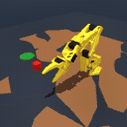
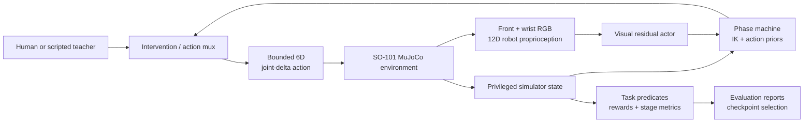

# SO-101 Gym-HIL

[](https://github.com/vriishin/so101-gym-hil/actions/workflows/testing.yml)
[](https://github.com/vriishin/so101-gym-hil/actions/workflows/quality.yml)
[](https://www.python.org/downloads/release/python-3100/)
[](LICENSE)

A deployment-minded robotics integration for SO-101 pick-and-place in MuJoCo: deterministic task
contracts, human intervention, stage-level observability, structured state control, and an honestly
evaluated visual/proprioceptive residual policy.



This project is best read as a systems case study. It connects simulation assets, control, task
semantics, teleoperation, data collection, learning, evaluation, and CI into one debuggable vertical
slice. The emphasis is on making failures measurable and recoverable—not presenting a narrow
simulation result as a solved general-robotics problem.

## Results at a glance

All results below are from simulation. Success means the cube was released in the target and remained
stable for the required hold period.

| System | Policy input | Evaluation | Stable success |
|---|---|---:|---:|
| Scripted acceptance oracle | Privileged simulator state | Seeds 0–19 | **20/20** |
| Structured state controller | 42D privileged state + phase priors | 20 fixed easy-reset seeds | **20/20** |
| Visual behavior-cloned residual actor | Front/wrist RGB + 12D proprioception | Seeds 18800–18819 | **7/20** |
| Demonstration-mixed SAC diagnostic | Same actor contract | Seeds 19000–19009 | **3/10** |

The state controller also passed the fixed and cube/target ±1 cm composition checks. The visual
dataset contains 100 successful teacher trajectories and 6,948 transitions. Online fine-tuning did
**not** improve the behavior-cloned initialization: later checkpoints drifted at the release boundary,
so the known-good initialization was retained. The regression suite contains 66 tests.

These are deliberately bounded claims. The state result uses privileged simulator state, structured
action priors, easy resets, and a contact-gated grasp assist. The visual actor does not receive object,
target, contact, reward, success, or phase features, but privileged state still powers the surrounding
phase machine and action priors. It is therefore a visual/proprioceptive **residual actor over a
structured controller**, not an end-to-end visual policy.

## System architecture



The separation is intentional:

- The deployable observation boundary has exactly three keys:
  `observation.images.front`, `observation.images.wrist`, and `observation.state`.
- A hard leakage guard rejects unexpected keys and common privileged-state names before policy input.
- Privileged state remains available to the teacher, curriculum, rewards, and diagnostics.
- Initial, best, selected, and final checkpoints are kept distinct and evaluated after reload.
- Stage metrics—reach, grasp, lift, target entry, release, stability, drop, and failure—localize
  regressions that a single episode return would hide.

## What this fork adds

The repository began from Hugging Face's `gym-hil` package and the official SO-101 assets from
`TheRobotStudio/SO-ARM100`. This fork adds the SO-101 vertical slice:

- A Gymnasium environment with normalized six-joint control, bounded randomized resets, dual RGB
  cameras, deterministic simulator-state resets, internal truncation, and explicit failure handling.
- Typed task predicates and four reward modes: sparse, naive dense, staged dense, and potential-based.
- A damped-Jacobian waypoint controller used as an executable acceptance oracle.
- Keyboard/gamepad human-intervention adapters that preserve requested and executed actions.
- Grasp, lift, transport, placement, descent, and release curricula with stage-aware telemetry.
- State SAC/behavior-cloning utilities and a dual-camera visual actor with demonstration-mixed SAC.
- Focused tests for control bounds, reset determinism, reward invariants, success semantics,
  intervention contracts, curricula, checkpoint structure, and visual leakage.

## Quick start

Python 3.10 is the tested version. MuJoCo runs headlessly for tests; a local display is needed only for
the interactive viewer.

```bash
git clone https://github.com/vriishin/so101-gym-hil.git
cd so101-gym-hil
python -m venv .venv
# Windows: .venv\Scripts\activate
# Linux/macOS: source .venv/bin/activate
python -m pip install --upgrade pip
python -m pip install -e ".[state-rl,visual-rl,test]"
python -m pytest -q
```

Run the privileged scripted oracle:

```bash
python scripts/run_scripted_policy.py --episodes 20 --seed-start 0
python scripts/run_scripted_policy.py \
  --episodes 1 --video outputs/scripted_validation/seed_0.mp4
```

Use the environment directly:

```python
import gymnasium as gym
import gym_hil  # registers the namespaced environments

env = gym.make(
    "gym_hil/SO101PickPlaceBase-v0",
    observation_mode="pixels_state",
    reward_mode="staged_dense",
)
observation, info = env.reset(seed=0)
observation, reward, terminated, truncated, info = env.step(env.action_space.sample())
env.close()
```

Launch human intervention with a keyboard or gamepad:

```bash
python scripts/teleoperate_so101.py --control keyboard
python scripts/teleoperate_so101.py --control gamepad
```

Keyboard controls are arrow keys for X/Y, Shift for Z, Ctrl for the gripper, Space to toggle
intervention, Enter/Backspace for manual success/failure, and Escape to exit. A physical gamepad was
not available for the reported validation run.

## Learning pipelines

The lightweight state-policy smoke path is:

```bash
python scripts/train_state_policy.py --config configs/training/state_sac.yaml
python scripts/evaluate_state_policy.py \
  --checkpoint outputs/state_sac_smoke/potential/seed_0/checkpoints/final.zip \
  --config outputs/state_sac_smoke/potential/seed_0/resolved_config.yaml \
  --episodes 5 --seed-start 2000
```

The visual experiment is intentionally a multi-stage reproduction. Generated datasets, replay
buffers, and model weights are not committed. First produce or provide the structured state teacher
referenced by `configs/training/visual_milestone5.yaml`, then run:

```bash
python scripts/record_visual_demonstrations.py \
  --config configs/training/visual_milestone5.yaml
python scripts/train_visual_bc.py \
  --config configs/training/visual_milestone5.yaml
python scripts/train_visual_rlpd.py \
  --config configs/training/visual_milestone5.yaml \
  --steps 10000 --run-name diagnostic_10k
```

The RLPD path is a local demonstration-mixed SAC implementation. It follows the inspected LeRobot
0.6-style feature names and replay-mixing semantics, but the LeRobot runtime itself was not installed
or executed. See [`docs/visual_policy_report.md`](docs/visual_policy_report.md) for the executed
experiment and release-drift diagnosis.

## Engineering decisions and failure analysis

Three examples capture the development approach:

1. **Acceptance before optimization.** A scripted controller and deterministic seed set established
   that the environment, success predicate, and task geometry were feasible before any training claim.
2. **Stage metrics over aggregate return.** An early action mask made lift unreachable; reachability
   probes exposed the issue immediately. Later, per-stage evaluation isolated visual-policy regression
   to release rather than reach, grasp, lift, transport, replay, or image processing.
3. **Preserve known-good behavior.** Training outputs record resolved configuration and Git metadata,
   and selection is based on independently reloaded checkpoints. The 10k online diagnostic was stopped
   when longer training added no stage-level improvement.

The contact-gated grasp-assist weld compensates for limitations in the upstream SO-101 gripper model.
It is activated only after geometric/contact checks and is reported here because it materially changes
the difficulty of transport.

## Repository map

```text
gym_hil/
  envs/so101_pick_place_env.py    # Environment and simulation contract
  controllers/so101_scripted.py  # Acceptance oracle and IK
  rewards/                        # Predicates and reward implementations
  wrappers/                       # HIL, curricula, state, and visual adapters
  training/                       # State and visual learning components
configs/training/                 # Reproducible experiment definitions
scripts/                          # Validation, teleoperation, train, and evaluate CLIs
tests/                            # 66 contract and regression tests
docs/visual_policy_report.md      # Results and failure diagnosis
```

## Limitations

- Simulation only; no real-robot or sim-to-real claim is made.
- State-policy results use a narrow easy-reset distribution and privileged structure.
- The visual actor relies on a privileged curriculum/action-prior scaffold.
- Demonstrations came from a privileged scripted/state teacher, not live human operators.
- The grasp-assist mechanism simplifies a difficult part of physical manipulation.
- The four reward modes are implemented, but a controlled multi-seed reward comparison remains future
  work.
- GPU rasterization can differ by one intensity level even when simulator state is deterministic.

## Provenance and license

Package structure and the original Panda environments come from
[`huggingface/gym-hil`](https://github.com/huggingface/gym-hil) at
`f89b3e5556798c44ef95083d92b670afa89d110a`. SO-101 meshes and model definitions come from
[`TheRobotStudio/SO-ARM100`](https://github.com/TheRobotStudio/SO-ARM100) at
`fda892cba81032c46c40976a48c9ceadbf40a9ca`. Asset-level details are recorded in
[`gym_hil/assets/so101/LICENSES.md`](gym_hil/assets/so101/LICENSES.md).

Licensed under Apache-2.0. Upstream copyright notices are preserved.
